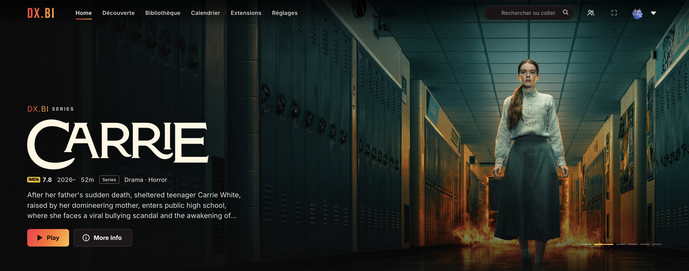

# Sunset for dx.bi

**A warm, fast, futuristic look for [dx.bi](https://github.com/notdxbi/dxbi-stremio).** Red → orange → gold accents on a warm black, finishes borrowed from Apple TV+, Netflix and Plex, and a performance mode that removes every blur and heavy effect so the interface stays smooth even on modest machines.

## Why a plugin and not a theme file?

dx.bi switches its built-in look off as soon as a `.theme.css` is applied, which means a classic theme has to ship a full copy of dx.bi's 4,500-line stylesheet and be re-merged at every dx.bi update. Sunset is a **plugin** instead: it lays its styles on top of the built-in dx.bi look. It survives dx.bi updates untouched, and it gets a settings page.

## What changes

- **Palette**: warm black background, matte warm surfaces, warm white text. The sunset gradient is reserved for the highlights — DX.BI wordmark, Play button, active tab underline, toggles, seek bar, Install/Configure buttons. Gold for IMDb ratings, links, "See all" and the player's thumb.
- **Home**: deeper shade at the bottom of the billboard, gradient Play button with a short glow, posters lift by 4 px with an orange ring on hover (no zoom), gradient "Continue watching" progress.
- **Details**: pill-shaped genres and cast, episode/streams panel with a thin sunset halo, selected episode marked with an orange bar.
- **Player**: gradient seek bar, gold thumb, gold icons on hover, matte subtitle/audio panels, gradient Skip Intro / Next Episode, crisp subtitle shadow.
- **Ergonomics**: gold focus ring for keyboard/remote navigation, marked selected option in menus, search field focus ring, thin scrollbars.

## Performance mode (default: on)

Removes every `backdrop-filter` blur (replaced by near-opaque surfaces), the large animated blurs (hover-card aura, billboard halo, 16-second Ken Burns zoom), poster zooms, row edge masks, and shortens entrance animations to 0.2 s. Only opacity and transform are animated — the GPU composites them without repainting. Switch it off in the plugin's settings if you have a powerful machine and want dx.bi's blurs back.

## Install

1. In dx.bi, keep the theme on **Default** and make sure **"dx.bi look built in"** is enabled in the dx.bi plugin's settings (it is by default).
2. Download [`sunset-theme.plugin.js`](https://raw.githubusercontent.com/Tipapoute/sunset-dxbi/main/sunset-theme.plugin.js) (right-click → *Save link as…*).
3. **Settings → dx.bi → Plugins → Open Plugins Folder**, drop the file there, switch the plugin on.

dx.bi checks this repository for updates, so new versions install themselves.

## Options

| Option | Default | What it does |
| --- | --- | --- |
| Performance mode | on | No blurs, no heavy animated effects, no poster zoom. |

## Credits

Made by **Tipapoute**. Built on top of the [dx.bi](https://github.com/notdxbi/dxbi-stremio) look.

## License

MIT
